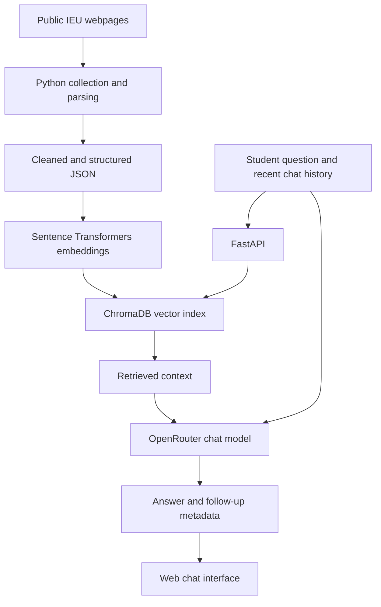

# EkoBot
### A Retrieval-Augmented Academic Assistant for İzmir University of Economics

EkoBot is a student-built academic information assistant designed to help İzmir University of Economics (IEU) students navigate course information and selected university resources. It combines a Python-based data collection pipeline, a ChromaDB vector store, and a conversational language model accessed through OpenRouter.

> **Project status:** Graduation project at İzmir University of Economics (IEU), not an official university service. EkoBot is an academic prototype and is not operated, endorsed, or maintained by the university. Its responses may be incomplete or outdated; students should verify important academic decisions against current official university sources.

---

## Overview

University information is often distributed across course pages, curriculum documents, and different service websites. EkoBot brings selected information from these public sources into a searchable knowledge base and uses retrieved context to support conversational answers.

The project focuses on:

- **Course information:** descriptions, prerequisites, credits, ECTS, weekly topics, and assessment information available on public course pages.
- **Academic information:** selected curriculum, department, academic-regulation, and university-service content collected from public IEU webpages.
- **Conversational interaction:** English- and Turkish-language questions, recent conversation context, and follow-up questions when more details are needed.
- **Source-aware retrieval:** semantic search over indexed documents to provide relevant context to the language model.
- **Deterministic regulation handling:** GPA-based semester credit limits are calculated in Python before retrieval and before any language-model call.

The system is intended as an information-navigation aid, not as an official academic advising or decision-making service.

## How it works

The data and response pipeline has six main stages:



1. **Collect** — Python scripts retrieve information from selected publicly accessible IEU webpages.
2. **Parse and structure** — HTML is cleaned and relevant information is extracted into structured JSON records and text chunks.
3. **Embed** — Sentence Transformers converts text into vector representations using `all-MiniLM-L6-v2`.
4. **Index and retrieve** — ChromaDB stores the vectors and returns semantically relevant documents for a question.
5. **Generate** — the retrieved context and recent conversation history are sent to a chat model through the OpenRouter API. GPA-based credit-limit questions are intercepted earlier and answered by deterministic Python rules.
6. **Respond** — the FastAPI backend returns the answer and, where applicable, follow-up information for the client.

## Data collection and provenance

The project team assembled its source list collaboratively and collected information page by page from publicly accessible pages on IEU's official website. The dataset was built by the project team; it was **not** supplied by the university, and no private university database was used.

The Python collection and processing work covers selected public information such as:

- Course descriptions, prerequisites, credits, ECTS, weekly topics, and assessment breakdowns.
- Department and curriculum information.
- Selected academic regulations and student-affairs information.
- Academic calendar, IT-support, career, and internship resources.

The collection scripts use source URLs, and source metadata is retained in the generated records where available so that information can be traced back to its originating webpage.

Examples of source areas include:

- [İzmir University of Economics](https://www.ieu.edu.tr/)
- [IEU Student Affairs](https://oim.ieu.edu.tr/)
- [IEU IT Support](https://itsupport.ieu.edu.tr/)
- [IEU Career](https://kariyer.ieu.edu.tr/)
- [IEU Computer Engineering](https://comp.izmirekonomi.edu.tr/)

Public accessibility does not necessarily grant permission to republish or commercially reuse website content. The generated data files are project snapshots; consult the relevant source websites before reusing their contents. The information may change, so the index should be refreshed when the source pages are updated.

## Technology stack

| Component | Technology |
|---|---|
| Backend API | Python, FastAPI, Uvicorn |
| Vector database | ChromaDB |
| Text embeddings | Sentence Transformers — `all-MiniLM-L6-v2` |
| Language-model access | OpenAI Python SDK, OpenRouter |
| Chat model configured in the current code | `meta-llama/llama-3-8b-instruct:free` |
| Web scraping and parsing | Requests, Beautiful Soup |
| Data format | JSON |
| Validation | Pydantic |
| Containerization | Docker |

The model name above is taken from the current `_MODEL` setting in `gemini.py`; it describes the repository's present configuration, not every model used during the project's development.

## My contribution

I took primary responsibility for the Python web-scraping and data-extraction pipeline: designing and implementing the core scripts that collect public course information, parse webpage content, and transform the extracted material into structured JSON data.

I also contributed to the project's data preparation and indexing workflow, ChromaDB-based retrieval components, and the conversational backend. The work was collaborative: source URLs were compiled with a teammate, and development of shared project modules included contributions from both team members.

This project gave me practical experience with web data acquisition, information extraction, data structuring, vector search, API development, and integrating retrieval with a conversational language model.

## Design lessons

### Deterministic rules for exact regulatory answers

An early version let the language model answer GPA-based semester credit-limit questions. It produced a plausible but unsupported number. The current flow detects these questions and applies the published GPA bands in Python before retrieval or any LLM call:

| GPA band | Maximum semester load |
|---|---:|
| Below 2.00 | 32 ECTS |
| 2.00–2.49 | 38 ECTS |
| 2.50 and above | 44 ECTS |

This keeps a rule with one exact answer out of the probabilistic generation step. The source regulation should still be checked for current applicability: [IEU regulations](https://www.ieu.edu.tr/en/bylaws/type/read/id/72).

### Calibrating retrieval distance

An initial rejection threshold of `0.75` was too strict for the observed ChromaDB cosine-distance values. Correct course matches in the tested queries appeared at distances of approximately `0.6–1.1`; the threshold was recalibrated to `1.5` after inspecting real query distances. For ChromaDB's cosine distance, lower values indicate closer matches; the distance is not a probability or a confidence percentage. The ChromaDB collection is explicitly configured with `hnsw:space=cosine` in the runtime, indexer, and database seeder. Rebuild an existing local index with `python indexer.py` after pulling this change so the cosine metric is applied to the stored collection. The threshold is an empirical project setting, not a universal guarantee of relevance.

## Project structure

| File or directory | Purpose |
|---|---|
| `main.py` | FastAPI application and chat endpoint |
| `gemini.py` | OpenRouter client, prompt construction, retrieval orchestration, and conversation flow |
| `credit_limits.py` | GPA credit-load question detection, GPA extraction, and deterministic ECTS rules |
| `scraper.py` | Course and selected university-page collection |
| `scraper_curriculum.py`, `scraper_info.py` | Additional curriculum and university-information collection |
| `parsing.py` | Department, course, curriculum, and regulation-related parsing and lookup helpers |
| `catalog.py`, `planning.py` | Course, department, curriculum, and planning-related data helpers |
| `embeddings.py` | Text embedding wrapper |
| `indexer.py` | Builds the ChromaDB knowledge index |
| `retrieval.py` | Course-focused retrieval helpers and distance threshold |
| `auto_eval.py` | Runs the question-based automated evaluation and writes reports |
| `run_eval_gate.py` | One-command wrapper that runs the evaluation and enforces the minimum pass-rate gate |
| `eval_questions.json` | 66 manually maintained evaluation questions and expected checks |
| `seed_ekobot_db.py` | Seeds or initializes the local ChromaDB database from project data |
| `tests/test_credit_limits.py` | Unit tests for the deterministic GPA credit-limit rules |
| `tests/run_flow_tests.py` | Lightweight conversation-flow checks |
| `website/` | Browser-based chat interface |

## Run locally

### Requirements

- Python 3.11
- An OpenRouter API key for live model responses
- Internet access for model and embedding downloads and for any source collection that requires live webpages

### 1. Clone the repository

```bash
git clone https://github.com/yasamanhaghshenas/EkoBot.git
cd EkoBot
```

### 2. Create a virtual environment and install dependencies

```bash
python -m venv .venv
source .venv/bin/activate
pip install -r requirements.txt
```

On Windows PowerShell:

```powershell
.venv\Scripts\Activate.ps1
```

### 3. Configure the API key

Set your OpenRouter API key as an environment variable.

macOS / Linux:

```bash
export OPENROUTER_API_KEY="your_openrouter_api_key"
```

Windows PowerShell:

```powershell
$env:OPENROUTER_API_KEY="your_openrouter_api_key"
```

Never commit API keys, tokens, or other credentials.

### 4. Build the vector index

```bash
python indexer.py
```

### 5. Start the API

```bash
uvicorn main:app --host 0.0.0.0 --port 7860
```

Open [http://localhost:7860](http://localhost:7860) for the web interface. FastAPI's interactive API documentation is available at [http://localhost:7860/docs](http://localhost:7860/docs).

### Docker

```bash
docker build -t ekobot .
docker run --rm -p 7860:7860 -e OPENROUTER_API_KEY="$OPENROUTER_API_KEY" ekobot
```

## Evaluation

The repository contains **66 manually maintained evaluation questions** in `eval_questions.json`. The evaluator also adds curriculum-derived failed-course cases and can generate additional cases to reach its configured target; therefore, the total number executed by the gate may be greater than 66.

Run the default offline/mock evaluation and quality gate from the repository root:

```bash
python run_eval_gate.py
```

The default mode is `direct-mocked`, and the default minimum pass-rate gate is 95%. To run against a live local API instead:

```bash
uvicorn main:app --host 127.0.0.1 --port 8000
python run_eval_gate.py --mode api --api-url http://127.0.0.1:8000/chat
```

The evaluator prints the number of cases, passed and failed checks, pass rate, and gate result, and writes timestamped JSON and Markdown reports under `reports/`. **No pass-rate result is claimed in this README until the command has been run against this repository state.** The three deterministic GPA-band unit tests can be run separately:

```bash
python -m unittest discover -s tests -p "test_credit_limits.py" -v
```

## API

### `GET /`

Serves the web interface when `website/index.html` is available; otherwise returns a basic API status response.

### `POST /chat`

Example request:

```json
{
  "question": "What are the prerequisites for SE 302?",
  "history": []
}
```

The response includes:

- `answer` — generated or deterministic response text.
- `is_followup` — whether the response is part of a follow-up flow.
- `options` — optional suggested replies.
- `followup_mode` — optional follow-up handling mode.
- `session_language` — detected session language.

## Limitations and responsible use

- EkoBot is a prototype and has not been presented as an authoritative source of academic policy.
- Retrieval quality depends on the coverage, freshness, and structure of the collected webpages.
- Language-model responses can be incorrect or incomplete, even when relevant context is retrieved.
- The automated evaluation checks expected response properties; it is not a measured end-to-end factual-accuracy benchmark.
- Always confirm prerequisites, graduation requirements, course availability, and other consequential decisions with IEU's current official sources.

## License

No open-source license has been added. Until a license is selected, the repository should be treated as **all rights reserved**; public visibility alone does not grant permission to reuse, modify, or redistribute the code or collected data.
